# Realtime Voice Handoff

<picture>
  <source media="(prefers-color-scheme: dark)" srcset="docs/how-it-works-dark.svg">
  
</picture>
<p align="center"><a href="docs/system-map.md">Full system map: 7 diagrams</a></p>

Use it when you need to cut off real audio and hand conversation state to another role over WebRTC, and want the handoff proven by a matching acknowledgement before the new role may speak. A caller moves from a scripted triage role to a specialist role. The old audio path stays muted, the state crosses a data channel, and the specialist can play only after a matching acknowledgement.

## Quickstart

Needs Node 22+. No install step: there are no dependencies.

```sh
npm test
node examples/demo.js
node examples/demo.js --input examples/handoff.json
```

The last command runs your own handoff request (a JSON file with `reason`, `history` and `slots`; copy `examples/handoff.json` and edit it) through the real controller and wire protocol. Real output:

```text
realtime-voice-handoff controller demo: PASS (5 of 5 checks)
  ok   triage audio interrupted and its path cancelled
  ok   specialist blocked until the ACK matched
  ok   matching ACK accepted, specialist became the owner
  ok   specialist played after the ACK
  ok   session closed with both paths cancelled
handoff handoff-2: reason user_requested, 2 message(s), topic billing, digest ade5e84ebcd575c8...
scope: deterministic controller and encoded protocol only; no audio was executed (use the browser lab for that)
Full trace: node examples/demo.js --json
```

Add `--json` for the full machine-readable trace. Invalid input exits 2 with a one-line message. No network access is used. To hear real audio, start the browser lab (see Browser lab below).

## Animated demo


[Watch the full-size recording](docs/showcase.mp4). This silent, 17.88-second
capture shows actual browser actions: connection, received triage audio,
interruption, typed context transfer, matching ACK, and specialist playback.
The controls and waveform use the running transport; the recording is not a
latency benchmark. Run the local page to hear the calibration tones.

The visual reference is [Midlife Engineering](https://www.midlife.engineering/),
listed on [Awwwards](https://www.awwwards.com/sites/midlife-engineering).
Instrument placement was measured at desktop and mobile sizes. Artwork,
branding, waveform, and code are original; font metrics and transition timing
differ from the reference. This is not a certified pixel-identical reproduction.



## Browser lab

Needs Python 3.11+ to serve the checkout and a browser with WebRTC, Web Audio, AudioWorklet, and Web Crypto. No API keys or external services.

```sh
python3 tools/serve.py --port 3405
```

(The server runs until you press Ctrl-C.) Open `http://127.0.0.1:3405/docs/index.html`, then use Connect to enable audio.
Calibration tones are available immediately. A local PCM WAV or an optional
microphone recording can be selected before playback. Recordings remain in
memory; no microphone permission is requested until the user chooses Record.
There is no automatic transcription or upload.

Each role can play once per session. Interrupt permanently cancels that role's
path. A new session creates new connections and gates. The master volume
changes the actual output gain; muting it also prevents a valid signal
precondition in an audio test.

## What runs locally

Four `RTCPeerConnection` objects form two pairs: callerT/triage and
callerS/specialist. Both use host ICE candidates, with no STUN or TURN server.
Web Audio supplies real tracks. The received tracks feed separate gates, PCM
probes, a master gain, and the actual audio destination.

Interrupt stops active and scheduled sources immediately and sets the old
receiver gate to zero permanently. The epoch counter invalidates callbacks;
it does not cancel RTP packets. The receiver gate handles packets already in
flight. Specialist audio uses its own pair and track.

A handoff has a two-second deadline covering hashing and delivery. The
specialist receives a bounded, validated snapshot over `RTCDataChannel` and
returns its session ID, handoff ID, epoch, and SHA256 digest. All four must
match. A snapshot receipt or an ACK send never starts audio by itself.
Timeout, interruption, or close invalidates the pending operation.

## API

```js
import {createVoiceLab} from './src/runtime.js';

const lab = createVoiceLab();
lab.subscribe(event => console.log(event.type));
await lab.connect(); // Call from a user gesture.
lab.play('triage-tone');
lab.interrupt('manual');
await lab.requestHandoff({
  reason: 'user_requested',
  history: [{id: 'u1', role: 'user', text: 'Please transfer.',
    source: 'typed', completion: 'complete'}],
  slots: {topic: 'technical', reference: null}
});
// requestHandoff resolves after sending, not after ACK acceptance.
// Wait for a state event with state.state === 'active_specialist'.
// Then lab.play('specialist-tone') is permitted.
```

`getState()` returns a copy. `getMetrics()` asynchronously returns measured
PCM windows/waveforms, selected ICE pairs, RTP statistics, and bounded event
history. `setVolume(0..1)` controls the final gain. `importWav(arrayBuffer)`
returns a local audio ID accepted by `play`. The eight most recent imported or
recorded clips stay in memory; older IDs are released. `startRecording()` starts optional
capture; `stopRecording()` resolves to an audio ID, or null if no samples were
captured. An automatic recording stop also emits `recording_stopped` with the
ID. `cancelRecording()` discards capture; `close()` releases media resources.

## Evidence and tests

Unit tests cover strict JSON and WAV parsing, state transitions, exact ACK
correlation, deadlines, asynchronous cancellation, scheduled source cleanup,
PCM windows, and the AudioWorklet's recording cap. These tests do not establish
that a browser transported audio.

Serve the checkout and open `/tests/browser-harness.html` for the actual
browser checks. Click **Start check**. It plays calibration tones without
requesting a microphone. The result is also available as `window.qaResult`.
The optional automation runner is documented by `python3 qa/browser_check.py
--help`; its Playwright dependency is isolated in `qa/requirements.txt`.

The harness requires a received signal before testing silence. It measures
20 ms PCM windows behind the output gain, tests a 100 ms cancellation target,
keeps observing the old track for a second, and checks a deliberately broken
cancellation implementation. A missing signal is INVALID, not a successful
silence test. Selected ICE pairs and increasing received RTP counters provide
separate transport evidence.

One local Chromium run on 2026-11-06 passed all seven browser checks with no
page errors or external HTTP requests. Its first stable silent PCM window
started 17.33 ms after interrupt, and the ten required post-interrupt windows
had RMS 0. The broken-cancellation control failed as intended. These are
measurements from one run, not a latency guarantee or a hardware audibility
claim. The [recorded measurement](examples/browser-measurement.json) includes
the windows, selected ICE pairs, and separate specialist/triage levels.

The [example JSON](examples/demo.json) is a deterministic controller trace.
It explicitly marks audio as not executed and transport as an in-memory test.
Browser results are separate measurements and are not generated from that
trace. Neither the trace nor automated PCM analysis proves that a person heard
sound through physical speakers or that a physical microphone worked.

## Limits

This is an audio transport and control project. It does not transcribe speech,
understand an utterance, call a language model, or synthesize a reply. The two
roles are deterministic local programs, not voice AI providers. The Quickstart
demo exercises the controller and wire protocol only; it executes no audio.

This is a single-browser loopback, not a production multi-device service or
NAT traversal test. SHA256 checks snapshot consistency; it does not authenticate
a participant. All roles share a trusted page. Audio controls depend on browser
permissions, autoplay policy, device availability, and scheduling.

WAV import accepts PCM16 little-endian mono, 8-48 kHz, up to ten seconds and
2 MiB. Microphone capture is downmixed/resampled by the Web Audio input path
to mono 48 kHz and capped at 480000 samples. `played_ms` is a source playback
position, not an estimate of heard words or audible duration.

LiveKit, STT, language models, and TTS are possible separate integrations.
They are not silently substituted or called by this project. See
[design](docs/design.md) and [threat model](docs/threat-model.md).
New code and synthetic examples use the [MIT license](LICENSE).
