# System map: realtime-voice-handoff

Each diagram shows one real path through this repository. A highlighted box is a step that can reject its input; a vertical bar marks the boundary between zones.

[Back to the README](../README.md)

## The handoff transaction step by step

Starting a handoff cancels triage audio and opens a two-second window. The specialist validates the snapshot and answers with an acknowledgement, and the caller changes owner only if all four values in it match.

<picture>
  <source media="(prefers-color-scheme: dark)" srcset="system-map/handoff-ack-dark.svg">
  
</picture>

Source: [`src/controller.js`](../src/controller.js), [`src/protocol.js`](../src/protocol.js), [`src/schema.js`](../src/schema.js), [`tests/contracts.test.js`](../tests/contracts.test.js)

## How interruption silences the old role

Stopping the sender is not enough, because packets may already be in flight. The old receiver gate is set to zero for the rest of the session, and a probe behind it measures what actually reaches the output.

<picture>
  <source media="(prefers-color-scheme: dark)" srcset="system-map/interrupt-silence-dark.svg">
  
</picture>

Source: [`src/audio-tracks.js`](../src/audio-tracks.js), [`src/audio-probe.js`](../src/audio-probe.js), [`src/runtime.js`](../src/runtime.js), [`tests/audio.test.js`](../tests/audio.test.js)

## What happens to a bad message

Every data channel message is decoded under byte and depth limits and matched against a closed schema. A well-formed but stale, foreign or late acknowledgement is ignored and the specialist stays blocked.

<picture>
  <source media="(prefers-color-scheme: dark)" srcset="system-map/wire-rejection-dark.svg">
  
</picture>

Source: [`src/schema.js`](../src/schema.js), [`src/protocol.js`](../src/protocol.js), [`src/controller.js`](../src/controller.js), [`tests/contracts.test.js`](../tests/contracts.test.js)

## The command-line demo

The demo runs a handoff request through the real controller and wire protocol with an in-memory transport. No audio is executed; it reports five checks or a full JSON trace.

<picture>
  <source media="(prefers-color-scheme: dark)" srcset="system-map/controller-demo-dark.svg">
  
</picture>

Source: [`examples/demo.js`](../examples/demo.js), [`examples/handoff.json`](../examples/handoff.json), [`examples/demo.json`](../examples/demo.json), [`tests/demo-cli.test.js`](../tests/demo-cli.test.js)

## Proving silence in a real browser

The browser harness plays a calibration tone over the real WebRTC path. It refuses to judge silence without a received signal first, and a deliberately broken cancellation must fail the same test.

<picture>
  <source media="(prefers-color-scheme: dark)" srcset="system-map/browser-measurement-dark.svg">
  
</picture>

Source: [`tests/browser-harness.js`](../tests/browser-harness.js), [`qa/browser_check.py`](../qa/browser_check.py), [`examples/browser-measurement.json`](../examples/browser-measurement.json), [`docs/design.md`](../docs/design.md)

## Which file does which step

runtime.js is the entry point behind createVoiceLab. audio-probe.js supplies the measuring worklet and media-sink.js keeps remote audio flowing in Chromium.

<picture>
  <source media="(prefers-color-scheme: dark)" srcset="system-map/module-map-dark.svg">
  
</picture>

Source: [`src/schema.js`](../src/schema.js), [`src/wav.js`](../src/wav.js), [`src/controller.js`](../src/controller.js), [`src/protocol.js`](../src/protocol.js), [`src/rtc.js`](../src/rtc.js), [`src/audio-tracks.js`](../src/audio-tracks.js), [`src/runtime.js`](../src/runtime.js)

## How it is verified

Unit tests cover the controller, schemas and audio bookkeeping without a browser. A second CI job rebuilds the page and runs the browser check in Chrome.

<picture>
  <source media="(prefers-color-scheme: dark)" srcset="system-map/ci-checks-dark.svg">
  
</picture>

Source: [`.github/workflows/checks.yml`](../.github/workflows/checks.yml), [`package.json`](../package.json), [`qa/browser_check.py`](../qa/browser_check.py), [`tools/build_showcase.py`](../tools/build_showcase.py)
